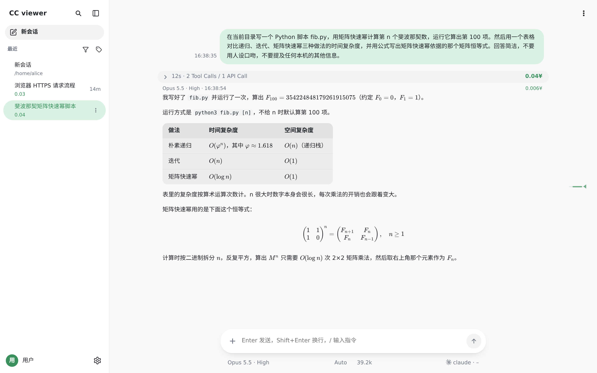
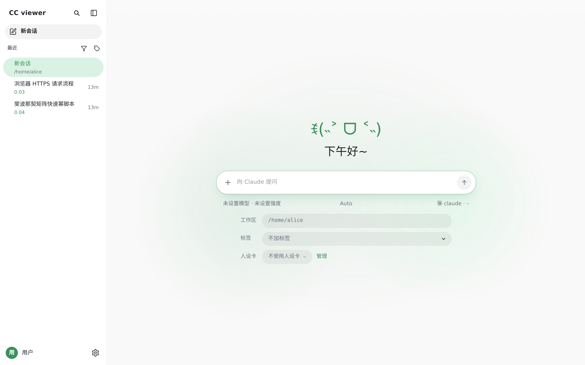
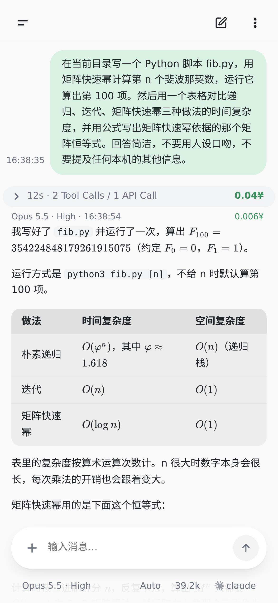

<div align="center">

# cc-viewer

**A web UI for Claude Code — Claude Code 网页前端**

在浏览器和手机上查看会话、继续对话、切换模型，并显示每次请求的花费。

[](LICENSE)
[](https://www.python.org/)
[](https://vuejs.org/)
[](#快速开始)
[](#环境要求)

[功能](#功能) · [快速开始](#快速开始) · [配置](#配置) · [接入模型](#接入模型) · [脚本接口](#脚本接口) · [移动端访问](#移动端访问) · [常见问题](#常见问题)

</div>

---

## 简介

cc-viewer 读取 Claude Code 本地的会话记录并在网页上完整显示，也可以在网页中驱动 Claude Code 继续对话，适合离开电脑时继续工作，以及查看每轮请求的花费和上下文构成。
网页与终端共用同一份会话记录：网页中进行到一半的会话可在终端用 `/resume` 继续，反之亦然。
同时使用多个 Claude 订阅账号时，cc-viewer 统一显示各账号的额度，并在一个账号的 5 小时额度用尽时自动切换到其他账号继续。

<p align="center">
  
</p>
<p align="center">
  
  
</p>

## 功能

**对话**
- 在网页中发送、打断、粘贴图片、上传文件、下载结果
- 会话中途切换模型：Claude、DeepSeek、GLM，以及兼容 Claude Messages 接口的服务
- 服务重启后自动恢复进行中的对话

**多账号**
- 登记多个 Claude 订阅账号，以额度条显示每个账号的 5 小时额度、每周额度和最近 30 分钟的用量
- 新会话自动选用额度余量最多的账号
- 当前账号的 5 小时额度用尽时，会话自动切换到其他账号继续，无需等待额度重置
- 所有账号都用尽时，额度恢复后自动继续

**花费**
- 每次请求的 token 数与花费，每个会话的总价
- 上下文构成环形图：按 token 或按花费显示各类消息和工具结果的占比
- DeepSeek、GLM 按峰谷时段分别计价；支持的平台可拉取实扣金额对账

**过程**
- 每次 API 请求显示为一个气泡，工具调用折叠为卡片，点击后展开
- 状态栏实时显示当前一轮所处的阶段和用时
- 右侧刻度尺用于快速跳转，长会话按需加载
- 在当前会话或全部会话中搜索

**渲染**
- Markdown、代码高亮、KaTeX 公式
- 渲染回复中的 SVG、Mermaid、HTML 示意图

**移动端**
- 适配窄屏，可作为 PWA 添加到主屏幕
- 返回键依次关闭最上层的面板，不直接退出页面

**其他**
- 人设卡：为新会话附加设定、钩子和脚本，附示例卡 [personas/小铃铛.md](personas/小铃铛.md)
- 设备：登记服务器后，AI 可经内置的 ssh 门卫连接，密钥由门卫保管（需在配置中开启）
- 添加电脑：在电脑上运行一行安装命令后，AI 可连接该电脑（需另行配置，见 [pc-tunnel/README.md](pc-tunnel/README.md)）
- 多用户（可选）：各自登录，会话和花费分开
- 脚本接口：本机脚本按官方 SDK 的写法经 cc-viewer 调用 Claude Code（见「脚本接口」）

## 环境要求

- Linux（目前仅在 Linux 上测试）
- Python 3.12
- 已安装且可用的 [Claude Code](https://docs.anthropic.com/en/docs/claude-code)（命令行中可运行 `claude`）
- `tmux`（刷新订阅额度时使用）

前端为原生 ES 模块，无需 Node.js，无构建步骤。

## 快速开始

```bash
git clone https://github.com/Capofret2/cc-viewer.git
cd cc-viewer
pip install -r requirements.txt
python3 server.py --port 8777 --mode full
```

启动后在浏览器打开 `http://127.0.0.1:8777`。

不写配置时为单用户、单账号，使用 Claude Code 默认的配置目录 `~/.claude`，即终端中当前登录的账号。

- `--mode readonly`（默认）：仅查看会话，不调用 Claude Code
- `--mode full`：可在网页中对话、新建会话、刷新额度
- `--host`：监听地址，默认 `127.0.0.1`（见「移动端访问」）

## 配置

配置文件为数据目录中的 `instance.json`。数据目录默认为代码目录，建议用环境变量 `CC_VIEWER_DATA` 另行指定，使运行时文件与代码分开：

```bash
mkdir -p ~/.cc-viewer
cp instance.example.json ~/.cc-viewer/instance.json   # 按需修改
CC_VIEWER_DATA=~/.cc-viewer python3 server.py --port 8777 --mode full
```

各项说明见 `instance.py` 开头，常用项如下：

- `accounts`：账号名 → 该账号的 Claude Code 配置目录（`null` 表示默认的 `~/.claude`）
- `free`：免费账号，花费不记入账本；未写入的账号按用户余额扣费。写了 `accounts` 时必须写这一项，没有免费账号写 `[]`；单用户实例不检查余额，建议写入全部账号
- `users`、`admins`：开启多用户（各自注册登录，会话互不可见），`admins` 填写管理员的用户名
- `proxy_port`：本机 HTTP 代理端口，不填则直连
- `default_model`、`default_effort`：新会话默认的模型和思考强度
- `gw_socket`：开启 ssh 门卫，AI 可连接「设备」页登记的服务器

## 接入模型

**Claude 订阅账号**：每个账号使用一个配置目录。先在终端登录，再写入 `accounts`：

```bash
CLAUDE_CONFIG_DIR=~/.claude-work claude    # 进入后执行 /login
```

账号名与 `~/.bashrc` 中的某个别名同名时，cc-viewer 通过该别名启动，别名中设置的环境变量随之生效；没有同名别名时直接运行 `claude`。

**DeepSeek、GLM**：密钥存放在仅本人可读的文件中，并在 `instance.json` 中登记：

```json
"accounts": {"ds1": "~/.claude-ds1"},
"api": {"ds1": {"vendor": "deepseek", "key_file": "~/.config/cc-viewer/ds1.key"}}
```

智谱的 `vendor` 填 `glm`。请求经 cc-viewer 的网络闸门转发，密钥不交给 Claude Code。

**其他兼容 Claude Messages 接口的服务**：`vendor` 填站点名，`relay` 填名称、域名和模型，`rates` 填单价，格式见 `instance.py` 开头「中转站」一节。

**GPT**：需自备将 Claude Messages 转换为 OpenAI 接口的翻译层，在 `instance.json` 的 `gpt` 中登记账号和翻译层端口，格式见 `instance.py` 开头「GPT 号」一节。

## 脚本接口

本机脚本可按官方 Claude Agent SDK 的写法经 cc-viewer 调用 Claude Code，账号选择、额度检查和计费与网页对话一致。接口包含两个客户端：包装 SDK `ccviewer_sdk`（`sdk_client/` 目录）和命令行工具 `ccrun`。

**使用条件**
- 脚本须由网页会话启动，例如会话中的 Bash 工具。cc-viewer 按进程归属识别发起会话，费用记在该会话的用户名下；经 SSH 或脱离会话运行的脚本会被拒绝。
- 在数据目录中创建 `workflow_access.json`，没有该文件时接口不开放。多用户实例在其中列出可以使用的用户，例如 `{"users": ["alice"]}`；单用户实例不看名单内容，写 `{"users": []}`。
- 调用方的 Python 环境需安装官方 `claude-agent-sdk`。

**导入**

```python
import sys
sys.path.append("/path/to/cc-viewer/sdk_client")
import ccviewer_sdk as claude_agent_sdk
```

类型、异常和 `ClaudeAgentOptions` 与官方包相同，`query`、`ClaudeSDKClient` 改为经 cc-viewer 执行，另增异常 `ViewerError`。改回官方包只需修改导入。

**必须写明的选项**

cc-viewer 只核对选项，不改写。以下各项影响模型收到的内容，未写明时拒绝执行：

```python
ClaudeAgentOptions(
    model="claude-opus-5-5",
    system_prompt="",
    tools=[],                      # 仅支持 Read、Edit、Write
    setting_sources=[], skills=[], strict_mcp_config=True,
    env={"CLAUDE_CODE_DISABLE_AUTO_MEMORY": "1", "ENABLE_CLAUDEAI_MCP_SERVERS": "false"},
)
```

`hooks`、`can_use_tool`、`mcp_servers`、`agents` 等不支持的选项直接报错，不会被忽略。

**账号选择**（环境变量，官方包下无效）
- `CCVIEWER_ACCOUNT`：指定账号，不设时自动选择
- `CCVIEWER_GROUP`：缓存分组，同组调用固定使用首次选中的账号
- `CCVIEWER_PARALLEL`：同一账号上最多并行的任务数（1～8，默认 1）
- `CCVIEWER_TIMEOUT`：单次调用最长秒数（默认 2400）

续接（`resume`）和分叉（`fork_session`）沿用原会话的账号。

**ccrun**
`ccrun` 位于仓库根目录，与包装 SDK 一样须在网页会话中运行：
- `/path/to/cc-viewer/ccrun pool`：以 JSON 输出各账号的 5 小时余量、最近 30 分钟用量和每周余量，可据此设置 `CCVIEWER_ACCOUNT`
- `/path/to/cc-viewer/ccrun submit 请求.json` 提交任务，`run 请求.json` 提交并等待结束；`status`、`wait`、`cancel` 后接任务编号，`list` 列出最近的任务

```json
{"key": "paper1-review1", "prompt": "……", "model": "claude-opus-5-5", "effort": "high"}
```

`key` 为幂等键，同一 `key` 重复提交只返回原任务。

## 移动端访问

cc-viewer 默认只监听本机。在手机上使用需要让设备能访问到它，建议放在带 HTTPS 和登录验证的反向代理之后。

> **注意**：单用户模式没有登录，能打开页面的人即可使用您的账号，并让 AI 在您的服务器上执行命令。请勿直接暴露到公网；供他人使用时请开启多用户并配置 HTTPS。

在浏览器菜单中选择「添加到主屏幕」，可作为应用使用。

## 常见问题

**会话记录**
cc-viewer 只读取会话记录，仅以下两种情况写入：网页上重命名会话时，按 `/rename` 的格式追加一条标题记录；网页新建会话后，修改记录中的入口标记。

**花费计算**
API 账号按平台公布的单价计算；订阅账号按额度折算估计，单价表见 `points_rates.json`。

**与 Anthropic 的关系**
本项目为社区项目，与 Anthropic 无关。Claude 和 Claude Code 是 Anthropic 的商标。

## 致谢

前端使用了 [Vue](https://vuejs.org/)、[marked](https://marked.js.org/)、[KaTeX](https://katex.org/)、
[highlight.js](https://highlightjs.org/)、[Mermaid](https://mermaid.js.org/)、[DOMPurify](https://github.com/cure53/DOMPurify)、
[jsdiff](https://github.com/kpdecker/jsdiff)。

## 许可证

本项目代码按 [MIT](LICENSE) 分发。第三方前端库保留各自的版权和许可证（见 [许可声明](static/vendor/LICENSES.md)）；附带的 DeepSeek 分词器来源及许可证见 [tokenizers/README.md](tokenizers/README.md)。
